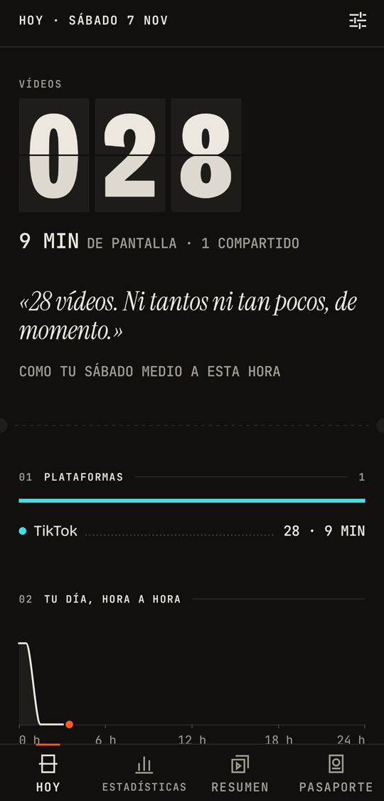
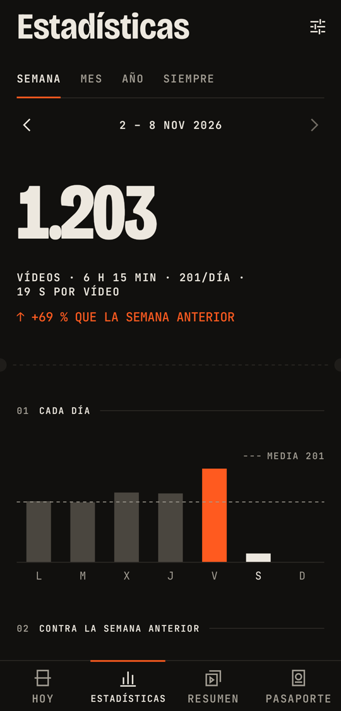
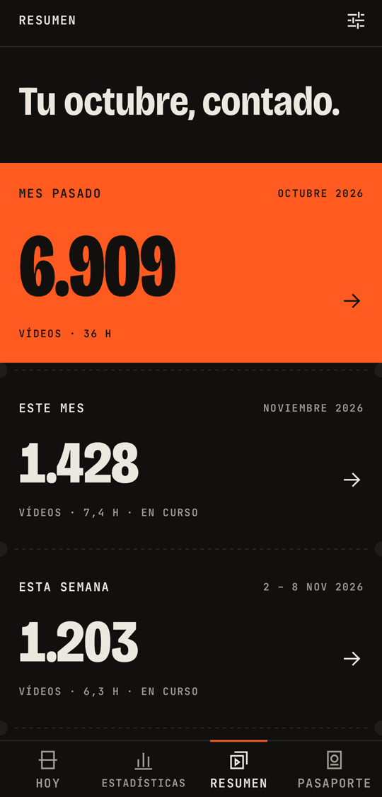
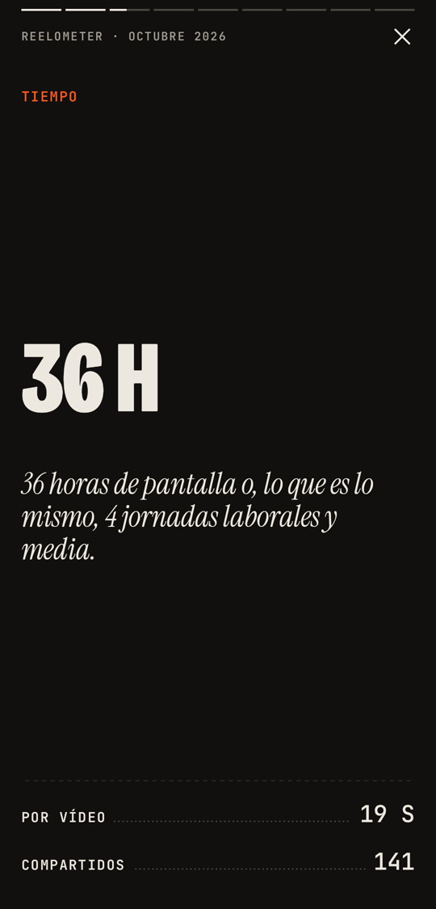
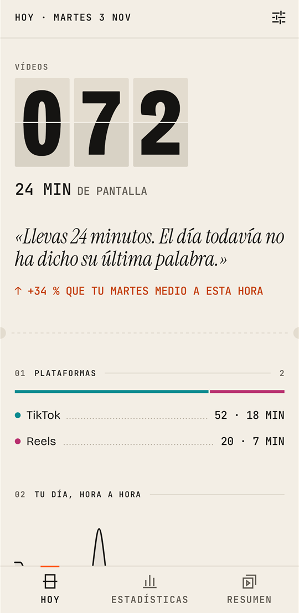
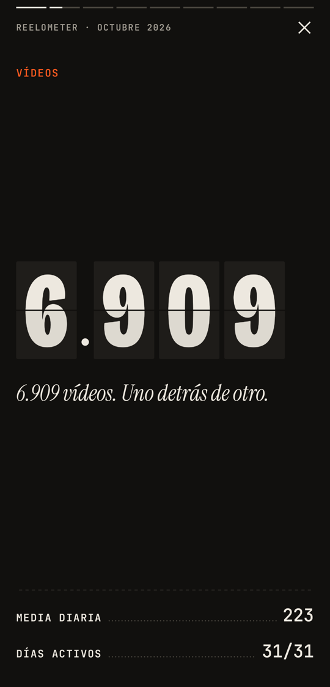
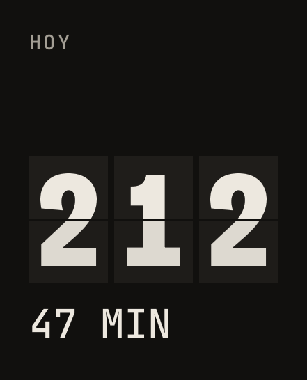

<div align="center">

**English** · [Español](README.md)


# Reelometer

**The scoreboard for your short videos.**

Counts the videos you watch on TikTok, Instagram Reels and YouTube Shorts: how many, for how long,
on which topics and from whom. Everything stays on your phone.


[](https://www.buymeacoffee.com/Lopuzno)

<br>






</div>

<br>

> *212 so far today. That's 47 minutes nobody is giving back to you.*

Reelometer doesn't block apps or lecture you. It just puts the scoreboard in front of you.

> **The app speaks English, Spanish (Spain), Brazilian Portuguese, French and Italian.** It follows your phone's
> language. Screenshots in this README are in Spanish; where it mentions a menu or button, the Spanish label is in
> parentheses.

## What it does

|  |  |
|---|---|
| **Today** (Hoy) | A scoreboard that flips like the departure boards at airports. Screen time, how you're doing compared with your average day at this same hour, platforms, your day hour by hour, topics and creators. |
| **Day** (Día) | Tap a bar or a day on the calendar to see that whole day: hour by hour, platforms, topics and creators, and how it ranks among your days. |
| **Statistics** (Estadísticas) | Week, month, year or all time. Bars with the average, this week versus last week, an activity calendar, your peak hour, your weakest day, streaks, seconds per video and your top 10 creators. |
| **Recap** (Resumen) | Every month, your full-screen recap in 9 slides, plus a 1080 × 1920 ticket to share, stamped PAID WITH YOUR TIME (PAGADO CON TU TIEMPO). |
| **Passport** (Pasaporte) | The game in reverse: you win by watching **less**. Flap, a pixel-art mascot that is fit or a scroll zombie depending on your week (it never dies), frequent-flyer levels, 23 stamps and a weekly challenge against your «ghost self» from last week. It can be hidden in Settings. |
| **Equivalences** | With that time you could read 14 books, walk the Camino de Santiago or make 120 Spanish omelettes. Every equivalence cites its source. |
| **Topics** | Sorts each video into 16 topics (humour, sport, food, gaming, learning…) from its description and hashtags, without leaving your phone. |
| **Widget and notifications** | A «Today» widget in 6 sizes (with Flap in the large one), a daily notification at the time you choose, a monthly one with your recap and, if you turn it on, one the moment you go over your goal. |
| **Goal** | If you want, a daily limit: the scoreboard tells you how much you have left and keeps your streaks. |
| **Who you send to** (A quién envías) | On Instagram and TikTok, and only if you turn it on (it's off by default): counts which people and groups you send videos to, so you can see who you share with most. |
| **Quick send** (Envío rápido) | On Instagram and TikTok, also off by default. Pin your usual people or groups (each app has its own) and bubbles with their photo appear over the videos: one tap and the video is sent by itself, in under a second. You can place the bubbles wherever you like, send to two at once by dropping one bubble onto another, and each bubble's photo can be their profile picture or one you choose from your gallery. |
| **Your data** | Export everything to CSV, import it on another phone (or after resetting this one) without duplicates, or delete it with one button. If you want, a weekly copy of the CSV in a folder on your phone that you choose (the last 4 are kept). |

<div align="center">



</div>

## Privacy

Reelometer uses Android's **accessibility service** to know when you move on to the next video. It's a powerful
permission, so the app is built so that it can't abuse it:

- **It has no `INTERNET` permission.** It can't send anything anywhere, even if it wanted to.
- No accounts, no servers, no ads, no analytics and no cloud backup.
- The service only listens to TikTok, Instagram and YouTube (`android:packageNames`). It reads nothing in any other app.
- For each video it stores the app, the time, how long it was on screen, the creator and the description. Never what
  you type or your messages. Who you share something with: only on Instagram and TikTok and only if you turn on «Who
  you send to» (it's off by default); then it stores the name of the person or group, on the phone.
- It doesn't tap anything for you, except with Instagram and TikTok **quick send** (off by default; it needs «Who you
  send to»): when you tap a bubble, it only taps «Share», the person or group you pinned and «Send» (if it can't see
  them, it looks them up in the sheet's search box; on TikTok, tapping its search icon first).
- It doesn't take screenshots, except one: only with quick send, it crops the profile picture of the people or groups
  you pin from the share sheet, to show it on their bubble; it keeps it only on this phone and takes no other
  screenshot. If you'd rather use another photo, you choose it with Android's photo picker, which asks for no
  permissions and only gives the app the photo you pick.
- Before you turn anything on, the app explains all of this on a screen of its own.
- The app's only link (to the project's GitHub, in Settings and in a notice shown at most twice) is opened by your
  browser: the app still has no internet and doesn't know whether you open it or support the project.

All the details are in the [privacy policy](PRIVACY.md) (in Spanish).

## How it works

```
TikTok · Instagram · YouTube
          │  accessibility events (scrolling, window changes, taps on «Share»)
          ▼
 ReelAccessibilityService
   ├─ FeedRules          is this the short-video feed? (rules as data, per platform)
   ├─ ViewTracker        a video counts if it's on screen for ≥ 600 ms; going back doesn't add another
   ├─ ContentExtractor   creator, description and hashtags of the visible page
   ├─ CategoryClassifier keywords → 16 topics
   ├─ ShareDetector      counts the «Share» taps
   ├─ RecipientDetector  who you send to on Instagram and TikTok (only if you turn it on)
   └─ QuickSender        quick send: Share → the person or group → Send
          │
          ▼
 Room (SQLite)  ──▶  ReelRepository (aggregates in SQL)  ──▶  Compose · Glance widget · WorkManager
```

Every platform changes its screens often, so the app includes a hidden **Calibration** console (Settings (Ajustes) ›
About (Acerca de) › tap the version 7 times; it then sits at the bottom, under «Licenses and tools») that shows live which events arrive and which videos it counts.

## Design: «the scoreboard»

No default Material. Ink background `#11100E` or paper `#F3EEE5`, bone `#EDE8DF` and a single orange accent
`#FF5A1F`. Bricolage Grotesque, JetBrains Mono and Instrument Serif typefaces. A 4 dp grid, no rounded cards, no
gradients, no emojis and spring animations. The only exception is the quick-send bubbles, which imitate glass so they
don't clash on top of Instagram and TikTok. The full system is in [`docs/DESIGN.md`](docs/DESIGN.md) (in Spanish).

## Install

It isn't on Google Play (yet). Download the APK of the latest version from
[Releases](https://github.com/SergioRE2007/reelometer/releases) and open it on your phone:

1. Android will ask you to allow your browser or file manager to «install unknown apps»: accept and install.
2. On Android 13 or later, the accessibility service switch is greyed out («Restricted setting») because the app
   doesn't come from Google Play. Go to the system Settings › Apps › Reelometer › ⋮ › **Allow restricted settings**
   and turn it on again. The app itself guides you.
3. New versions install on top and keep your data. To switch phones: Settings › Your data › **Export CSV** on the
   old one and **Import CSV** on the new one.

Requirements: Android 8.0 (API 26) or later. Languages: English, Spanish (Spain), Brazilian Portuguese, French and
Italian (it follows the phone; on Android 13 or later you can pick one inside the app, in Settings › Theme › Language).

## Build

You need Android Studio (or its JDK) and the Android SDK.

```bash
git clone https://github.com/SergioRE2007/reelometer.git
cd reelometer
./gradlew assembleDebug testDebugUnitTest   # debug APK + JVM tests
./gradlew assembleRelease                   # unsigned release
```

If Gradle can't find the SDK, create `local.properties` with `sdk.dir=/path/to/Android/Sdk` or open the project in
Android Studio. The debug build includes a component gallery and a sample-data generator (Settings (Ajustes) ›
Licenses and tools › Debugging (Depuración)).

### Technology

Kotlin 2.4 · Jetpack Compose · Navigation · Room · DataStore · WorkManager · Glance · kotlinx-serialization ·
Robolectric. `minSdk 26`, `targetSdk 37`.

### Structure

```
app/src/main/java/com/reelometro/app/
├── detection/   accessibility service, per-platform rules, classifier, «Who you send to» and quick send
├── data/        Room, repository, settings (DataStore), CSV export and import
├── stats/       pure calculations, number formatting, sourced equivalences
├── copy/        all the app's text (with variants)
├── game/        pure Passport rules (Flap, levels, stamps, challenge)
├── work/        daily, monthly, live and level-up notifications
├── widget/      «Today» widget with Glance
└── ui/          theme, components (split-flap scoreboard, ticket…) and screens
```

## Status

Version **1.10.0**. Honestly:

- **Tested on a real phone** (a Pixel with Android 17): TikTok and Instagram count correctly. Instagram quick send has
  been measured send by send: between 0.5 and 0.93 s to a person and 1.4–1.6 s to a group that has to be searched for
  (almost all of that time is Instagram's search). The bubbles and the photo chosen from the gallery have also been
  tested on that phone.
- **Quick send on TikTok** (1.10.0, TikTok 47.7): measured on that phone, 11 sends in a row to a contact who appears on
  the sheet, all between 0.5 and 0.67 s, the tenth as fast as the first. Not tested on the phone yet: the search path
  (when the pinned contact isn't on the sheet; tested with the real screen tree in tests) and TikTok in other
  languages. TikTok changes its screen identifiers with every version: if an update breaks it, the send stops and
  leaves the sheet open for you to finish by hand.
- **YouTube Shorts** (1.6.1): calibrated with a real log from a Pixel (YouTube 21.44). It used to count about 6 out of
  27 Shorts; in a check round it now counted 7 out of 7. YouTube changes without notice: if it stops adding up, the
  Calibration console shows why.
- **Checked on the emulator**: the main screens in light and dark theme and with the font at 130 %, and the release
  build going through every route without crashes.
- **Not checked yet**: the Passport and the guided tour haven't had a full visual review on screen; quick send with
  Instagram in another language (the app recognises «Send» by its identifier and by the word in several languages,
  but it has only been tested in Spanish); and other phones and Android versions.
- **New translations** (English, Brazilian Portuguese, French and Italian): checked on screen in the emulator, but
  no native speaker has read them in full yet, and texts quoting Android menus or Instagram buttons may not match
  your phone word for word. Corrections are welcome.
- **Import CSV** (1.6.0): covered by tests (round trip through the database, CSVs from every earlier version,
  importing twice without duplicates), on the emulator and with a real CSV from a Pixel
  (798 videos: all of them come in, and none is duplicated on a second import).
- **1.7.0**: charts can be scrubbed by sliding a finger sideways (no long press) and Settings has an index at the
  top that jumps to each section; quick send and the tools are folded. Tested on the emulator.
- It builds and passes its 969 JVM tests. The screenshots in this README use sample data.

## Support the project

Reelometer is made by a student in their spare time. It's free, has no ads and no internet. If it's useful to you
and you feel like it, you can buy them a coffee.

<a href="https://www.buymeacoffee.com/Lopuzno"></a>

## License

All rights reserved. You can read the code to understand how the app works, but you may not copy it, modify it or use
it in other projects without the author's permission. Details in [LICENSE](LICENSE). The typefaces have their own
licence (SIL Open Font License 1.1).

## Disclaimer

Reelometer is an independent project. It is not affiliated with, sponsored or endorsed by TikTok, Instagram, YouTube
or their companies. The names are used only to indicate which apps it works with.
