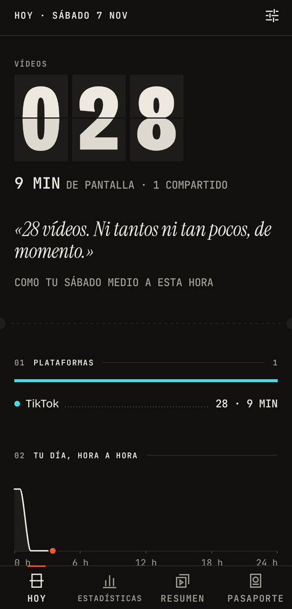
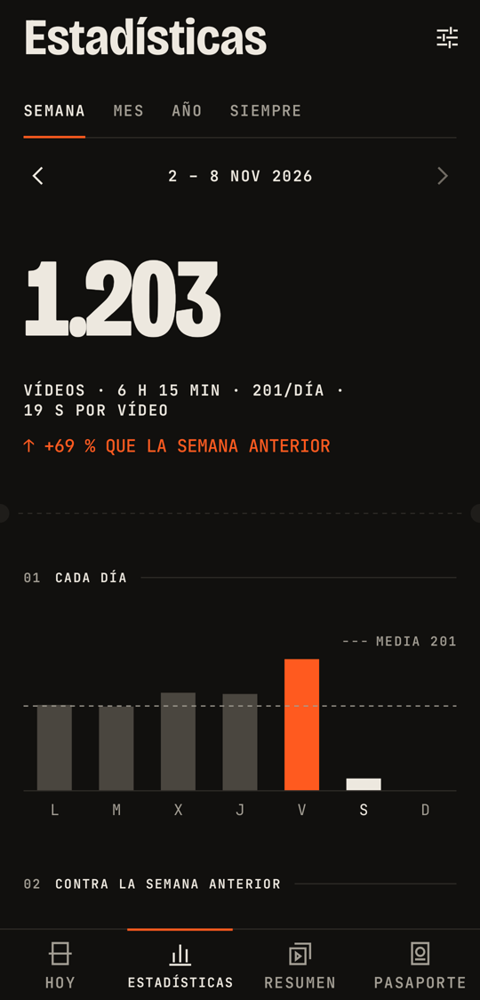
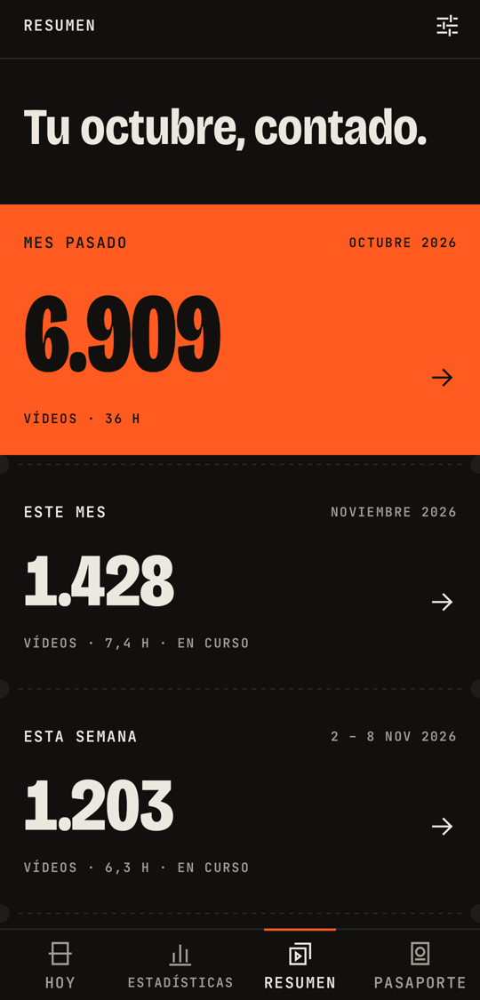
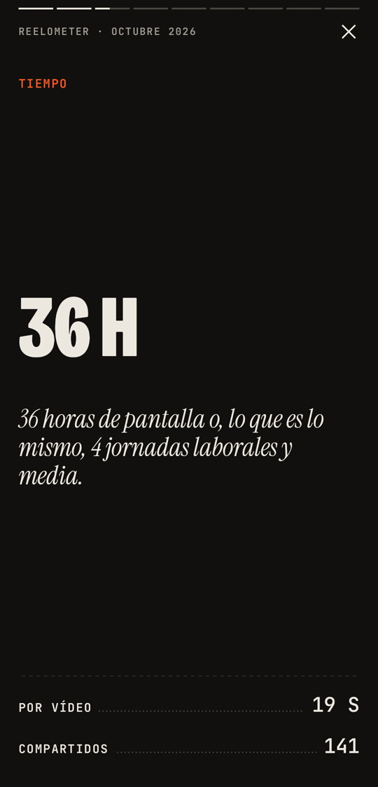
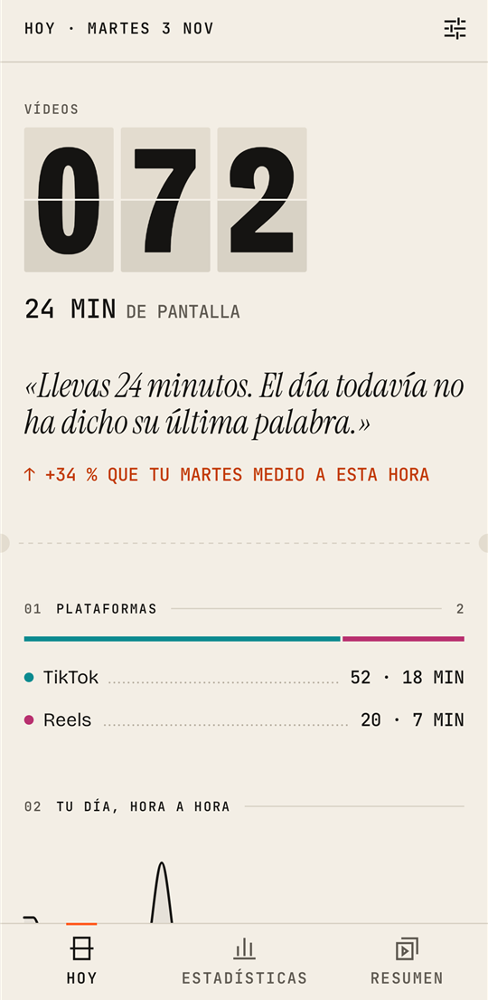
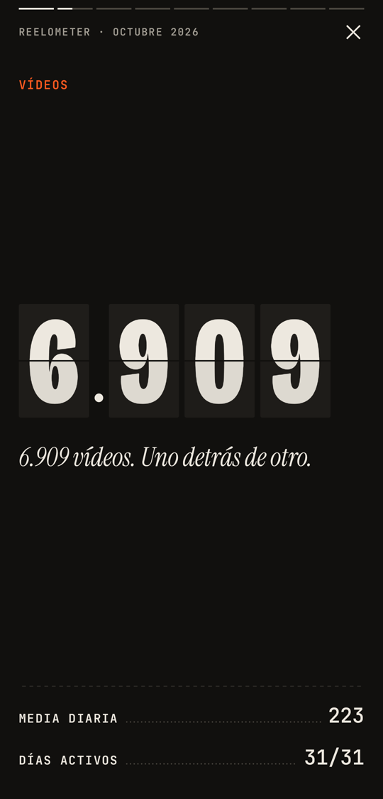
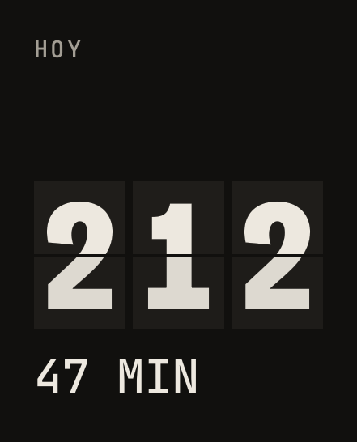

<div align="center">

[English](README.en.md) · **Español**


# Reelometer

**El marcador de tus vídeos cortos.**

Cuenta los vídeos que ves en TikTok, Instagram Reels y YouTube Shorts: cuántos, cuánto tiempo,
de qué temas y de quién. Todo se queda en tu móvil.

**[sergiore2007.github.io/reelometer](https://sergiore2007.github.io/reelometer/)**


[](https://www.buymeacoffee.com/Lopuzno)

<br>






</div>

<br>

> *Hoy llevas 212. Eso son 47 minutos que nadie te va a devolver.*

Reelometer no bloquea apps ni te echa sermones. Solo te pone el marcador delante.

## Qué hace

|  |  |
|---|---|
| **Hoy** | Un marcador que voltea como los paneles de los aeropuertos. Tiempo de pantalla, cómo vas frente a tu día medio a esta misma hora, plataformas, tu día hora a hora, temas y creadores. |
| **Día** | Toca una barra o un día del calendario y ves ese día entero: hora a hora, plataformas, temas y creadores, y qué puesto ocupa entre tus días. |
| **Estadísticas** | Semana, mes, año o desde siempre. Barras con la media, la semana frente a la anterior, un calendario de actividad, tu hora punta, tu día débil, rachas, segundos por vídeo y tu top 10 de creadores. |
| **Resumen** | Cada mes, tu repaso a pantalla completa en 9 diapositivas, y un ticket de 1080 × 1920 para compartir con su sello: PAGADO CON TU TIEMPO. |
| **Pasaporte** | El juego al revés: se gana viendo **menos**. Flap, una mascota en pixel art que está en forma o zombi del scroll según tu semana (nunca muere), niveles de viajero frecuente, 23 sellos y un reto semanal contra tu «yo fantasma» de la semana pasada. Se puede ocultar en Ajustes. |
| **Equivalencias** | Con ese tiempo podrías leer 14 libros, hacer el Camino de Santiago o 120 tortillas de patatas. Cada equivalencia lleva su fuente. |
| **Temas** | Reparte cada vídeo entre 16 temas (humor, deporte, comida, gaming, aprendizaje…) a partir de su descripción y hashtags, sin salir del móvil. |
| **Widget y avisos** | Widget «Hoy» en 6 tamaños (con Flap en el grande), un aviso diario a la hora que elijas, uno mensual con tu resumen y, si lo activas, uno en el momento en que pasas tu objetivo. |
| **Objetivo** | Si quieres, un límite diario: el marcador te dice cuánto te queda y lleva tus rachas. |
| **A quién envías** | En Instagram y TikTok, y solo si lo enciendes (viene apagado): cuenta a qué personas y grupos mandas vídeos, para ver con quién compartes más. |
| **Envío rápido** | En Instagram y TikTok, también apagado de serie. Fija a tus personas o grupos de siempre (cada app con los suyos) y sobre los vídeos salen unas burbujas con su foto: un toque y el vídeo se envía solo, en menos de un segundo. Las burbujas se colocan donde quieras, puedes mandar a dos a la vez soltando una encima de otra y la foto de cada burbuja puede ser la de su perfil o una que elijas de tu galería. |
| **Tus datos** | Exporta todo a CSV, impórtalo en otro móvil (o tras restablecer este) sin duplicar nada, o bórralo con un botón. Si quieres, una copia semanal del CSV en una carpeta del móvil que eliges tú (se quedan las 4 últimas). |

<div align="center">



</div>

## Privacidad

Reelometer usa el **servicio de accesibilidad** de Android para saber cuándo pasas de vídeo. Es un permiso
potente, así que la app está hecha para no poder abusar de él:

- **No tiene permiso `INTERNET`.** No puede enviar nada a ningún sitio, ni aunque quisiera.
- Sin cuentas, sin servidores, sin anuncios, sin analítica y sin copia de seguridad en la nube.
- El servicio solo escucha a TikTok, Instagram y YouTube (`android:packageNames`). En el resto de apps no lee nada.
- De cada vídeo guarda la app, la hora, cuánto estuvo en pantalla, el creador y la descripción. Nunca lo que
  escribes ni tus mensajes. A quién compartes algo, solo en Instagram y TikTok y solo si enciendes «A quién envías»
  (viene apagado): entonces guarda el nombre de la persona o el grupo, en el móvil.
- No pulsa nada por ti, salvo con el **envío rápido** de Instagram y TikTok (viene apagado y necesita «A quién
  envías»): al tocar una burbuja, pulsa únicamente «Compartir», la persona o el grupo que has fijado y «Enviar» (si no
  lo ve, lo busca en el buscador de la hoja; en TikTok, tocando antes su lupa).
- No hace capturas de pantalla, salvo una: solo con el envío rápido, recorta de la hoja de compartir la foto de perfil
  de las personas o grupos que fijas, para enseñarla en su burbuja; la guarda solo en este móvil y no hace ninguna otra
  captura. Si prefieres otra foto, la eliges con el selector de fotos de Android, que no pide permisos y solo le da a
  la app la foto que tú eliges.
- Antes de activar nada, la app explica todo esto en una pantalla propia.
- La app solo tiene dos enlaces: la política de privacidad (Ajustes › Privacidad) y el GitHub del proyecto (en Ajustes y en
  un aviso que sale como mucho dos veces). Los abre tu navegador: la app sigue sin internet y no sabe si los abres ni si
  apoyas el proyecto.

Todos los detalles están en la [política de privacidad](https://sergiore2007.github.io/reelometer/privacidad/) (también en [PRIVACY.md](PRIVACY.md)).

## Cómo funciona

```
TikTok · Instagram · YouTube
          │  eventos de accesibilidad (desplazamiento, ventana, clic en «Compartir»)
          ▼
 ReelAccessibilityService
   ├─ FeedRules          ¿esto es el feed de vídeos cortos? (reglas como datos, por plataforma)
   ├─ ViewTracker        un vídeo cuenta si está ≥ 600 ms en pantalla; volver atrás no suma otro
   ├─ ContentExtractor   creador, descripción y hashtags de la página visible
   ├─ CategoryClassifier palabras clave → 16 temas
   ├─ ShareDetector      cuenta los «Compartir»
   ├─ RecipientDetector  a quién envías en Instagram y TikTok (solo si lo enciendes)
   └─ QuickSender        envío rápido: Compartir → la persona o el grupo → Enviar
          │
          ▼
 Room (SQLite)  ──▶  ReelRepository (agregados en SQL)  ──▶  Compose · Widget Glance · WorkManager
```

Cada plataforma cambia sus pantallas a menudo, así que la app trae una consola de **Calibración** oculta (Ajustes ›
Acerca de › toca 7 veces la versión; queda al final, en «Licencias y herramientas») que muestra en directo qué eventos llegan y qué vídeos cuenta.

## Diseño: «el marcador»

Nada de Material por defecto. Fondo tinta `#11100E` o papel `#F3EEE5`, hueso `#EDE8DF` y un único acento
naranja `#FF5A1F`. Tipografías Bricolage Grotesque, JetBrains Mono e Instrument Serif. Retícula de 4 dp, sin
tarjetas redondeadas, sin degradados, sin emojis y animaciones con muelles. La única excepción son las burbujas del
envío rápido, que imitan el cristal para no desentonar encima de Instagram y TikTok. El sistema completo está en
[`docs/DESIGN.md`](docs/DESIGN.md).

## Instalar

No está en Google Play (todavía). Descarga la APK de la última versión en
[Releases](https://github.com/SergioRE2007/reelometer/releases) y ábrela en el móvil:

1. Android te pedirá permitir «instalar apps desconocidas» al navegador o al gestor de archivos: acéptalo e instala.
2. En Android 13 o superior, el interruptor del servicio de accesibilidad sale gris («Ajuste restringido») porque la
   app no viene de Google Play. Ve a Ajustes del sistema › Apps › Reelometer › ⋮ › **Permitir ajustes restringidos**
   y vuelve a activarlo. La propia app te guía.
3. Las versiones nuevas se instalan encima y conservan tus datos. Para cambiar de móvil: Ajustes › Tus datos ›
   **Exportar CSV** en el viejo e **Importar CSV** en el nuevo.

Requisitos: Android 8.0 (API 26) o superior. Idiomas: español de España, inglés, portugués de Brasil, francés e
italiano (sigue el del móvil; en Android 13 o superior se puede elegir dentro de la app, en Ajustes › Tema › Idioma).

## Compilar

Necesitas Android Studio (o su JDK) y el SDK de Android.

```bash
git clone https://github.com/SergioRE2007/reelometer.git
cd reelometer
./gradlew assembleDebug testDebugUnitTest   # APK debug + tests JVM
./gradlew assembleRelease                   # release sin firmar
```

Si Gradle no encuentra el SDK, crea `local.properties` con `sdk.dir=/ruta/al/Android/Sdk` o abre el proyecto en
Android Studio. La build debug incluye una galería de componentes y un generador de datos de ejemplo (Ajustes ›
Licencias y herramientas › Depuración).

### Tecnología

Kotlin 2.4 · Jetpack Compose · Navigation · Room · DataStore · WorkManager · Glance · kotlinx-serialization ·
Robolectric. `minSdk 26`, `targetSdk 37`.

### Estructura

```
app/src/main/java/com/reelometro/app/
├── detection/   servicio de accesibilidad, reglas por plataforma, clasificador, «A quién envías» y envío rápido
├── data/        Room, repositorio, ajustes (DataStore), exportación e importación CSV
├── stats/       cálculos puros, formato de cifras, equivalencias con fuente
├── copy/        todos los textos de la app (con variantes)
├── game/        reglas puras del Pasaporte (Flap, niveles, sellos, reto)
├── work/        avisos diario, mensual, en directo y de nivel
├── widget/      widget «Hoy» con Glance
└── ui/          tema, componentes (marcador split-flap, ticket…) y pantallas
```

## Estado

Versión **1.10.3** (la política de privacidad, enlazada desde Ajustes). Con honestidad:

- **Probado en un móvil real** (un Pixel con Android 17): TikTok e Instagram cuentan bien. El envío rápido de
  Instagram está medido envío a envío: entre 0,5 y 0,93 s a una persona y 1,4–1,6 s a un grupo que hay que buscar
  (casi todo ese tiempo es la búsqueda de Instagram). Las burbujas y la foto elegida de la galería también se han
  probado en ese móvil.
- **Envío rápido en TikTok** (1.10.0, TikTok 47.7): medido en ese móvil, 11 envíos seguidos a un contacto que sale en la
  hoja, todos entre 0,5 y 0,67 s, el décimo igual de rápido que el primero. Sin probar en el móvil: el camino del
  buscador (cuando el fijado no sale en la hoja; probado con el árbol real en tests) y TikTok en otros idiomas. TikTok
  cambia los identificadores de su pantalla en cada versión: si una actualización lo rompe, el envío se para y deja la
  hoja abierta para terminar a mano.
- **YouTube Shorts** (1.6.1): calibrado con un registro real de un Pixel (YouTube 21.44). Antes contaba unos 6 de cada
  27 Shorts; ahora, en una ronda de comprobación, 7 de 7. Las versiones de YouTube cambian sin avisar: si deja de
  cuadrar, la consola de Calibración dice por qué.
- **Comprobado en el emulador**: las pantallas principales en tema claro y oscuro y con la fuente al 130 %, y la
  release recorriendo todas las rutas sin cierres.
- **Sin comprobar todavía**: el Pasaporte y el recorrido guiado no han tenido una revisión visual completa en
  pantalla; el envío rápido con Instagram en otro idioma (la app reconoce «Enviar» por su identificador y por la
  palabra en varios idiomas, pero solo se ha probado en español); y otros móviles y versiones de Android.
- **Traducciones nuevas** (inglés, portugués de Brasil, francés e italiano): revisadas en pantalla en el emulador,
  pero todavía no las ha leído enteras un hablante nativo, y los textos que citan menús de Android o botones de
  Instagram pueden no coincidir palabra por palabra con lo que muestra tu móvil. Las correcciones son bienvenidas.
- **Importar CSV** (1.6.0): probado con tests (ida y vuelta con la base de datos, CSV de todas las versiones
  anteriores, importar dos veces sin duplicar), en el emulador y con el CSV real de un Pixel
  (798 vídeos: entran todos y, al repetir, ninguno se duplica).
- **1.7.0**: las gráficas se recorren deslizando el dedo en horizontal (sin mantener pulsado) y Ajustes tiene un
  índice arriba que salta a cada sección; el envío rápido y las herramientas van plegados. Probado en el emulador.
- Compila y pasa sus 969 tests JVM. Las capturas de este README usan datos de ejemplo.

## Apoyar el proyecto

Reelometer lo hace un estudiante en sus ratos libres. Es gratis, no tiene anuncios y no tiene internet. Si te sirve y
te apetece, puedes invitarle a un café.

<a href="https://www.buymeacoffee.com/Lopuzno"></a>

## Licencia

Todos los derechos reservados. Puedes ver el código para entender cómo funciona la app, pero no copiarlo,
modificarlo ni usarlo en otros proyectos sin permiso del autor. Detalles en [LICENSE](LICENSE). Las tipografías
tienen su propia licencia (SIL Open Font License 1.1).

## Aviso

Reelometer es un proyecto independiente. No está afiliado, patrocinado ni respaldado por TikTok, Instagram,
YouTube ni sus empresas. Los nombres se usan solo para indicar con qué apps funciona.
